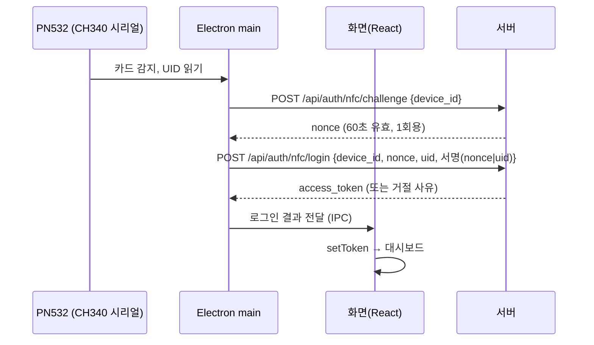

# BENCH 데스크톱 클라이언트 구현 계획

> 작성: 2026-10-17 · 상태: **계획(승인 전)** · 대상: Electron 클라이언트, NFC 로그인, 사내 메신저, 메일 기능 검토

## 0. 요약

| 항목 | 방향 |
|---|---|
| 클라이언트 | Electron 셸을 얇게 만들고 화면은 **지금 React 화면을 서버에서 그대로 불러온다**. 셸에는 NFC·알림·트레이 같은 PC 기능만 둔다 |
| 운영체제 | Windows부터. 같은 코드로 macOS(dmg)·Linux(AppImage/deb)까지 빌드한다(electron-builder) |
| NFC 로그인 | 지금 가진 **PN532 모듈(USB-시리얼 CH340, 115200bps)** 로 카드 UID를 읽는다(시리얼 통신으로 PN532 명령을 직접 보낸다). **관리자가 승인한 PC에서만** 카드 로그인을 받는다(기기 서명 확인). 이메일+비밀번호 로그인은 그대로 둔다 |
| 직원 등록 | 직원 수정 화면에 "NFC 카드" 칸을 둔다(등록·이름 붙이기·사용 중지). UID 원문은 저장하지 않고 HMAC 값으로 저장한다 |
| 메신저 | 1:1·그룹 대화, 읽음 표시, 파일 첨부. 보내기는 REST, 받기는 WebSocket. **웹 브라우저에서도 같은 화면으로 쓸 수 있다** |
| 메일 | 검토 결과 **전체 메일 프로그램은 만들지 않는 것을 권한다**. 대신 ① 견적서·거래명세서 PDF를 메일로 보내는 기능, ② 웹메일 바로가기와 안 읽은 메일 수 표시를 권한다(§6) |

진행 전에 정해야 할 사항은 §8에 따로 모았다. DB 구조 추가와 로그인 방식 추가가 들어 있어서 **각 단계에 들어가기 전에 승인을 받는다**.

---

## 1. 현재 구조에서 확인한 점

- 인증: `POST /api/auth/login`(이메일+비밀번호)이 JWT를 준다(`sub`=이메일, 12시간). 토큰은 브라우저 `localStorage`에 둔다. 로그인 실패 제한은 서버 메모리(`core/login_throttle.py`)에서 센다.
- 토큰을 되돌리는(폐기) 기능이 없다. 카드를 사용 중지해도 이미 받은 토큰은 만료될 때까지 쓸 수 있다(§3.6).
- 직원 관리: `routers/users.py`와 `features/settings/UserFormPage.tsx`. 권한은 `require_admin_or_site_admin`을 쓴다.
- 알림: `notifications` 표에 저장하고, 사이드바가 20초마다 안 읽은 수를 묻는다(`Sidebar.tsx`의 `UNREAD_POLL_MS`). 서버가 먼저 알려 주는 통로(WebSocket)는 아직 없다. `websockets` 패키지는 이미 설치돼 있다.
- 화면은 `/api`를 상대 경로로 부른다. 서버 주소에서 화면을 불러오면 화면 코드를 고치지 않아도 된다.
- 서버는 프로세스 하나로 도는 것을 전제로 한다(로그인 실패 제한과 같다). 메신저의 접속 관리도 같은 전제로 단순하게 만든다.

---

## 2. Electron 클라이언트

### 2.1 화면을 어디서 불러올지 — 서버에서 불러오기(권장)

| | A. 서버 화면 불러오기 (권장) | B. 화면을 앱에 넣어 배포 |
|---|---|---|
| 화면 업데이트 | 서버만 바꾸면 모든 PC에 바로 반영 | 바뀔 때마다 앱을 다시 배포 |
| 코드 변경 | 거의 없음(같은 주소, CORS 불필요) | API 주소를 절대 주소로, CORS 허용, 라우터를 Hash 방식으로 바꿔야 함 |
| 서버가 꺼졌을 때 | 앱 안의 "서버에 연결할 수 없음" 화면 + 다시 시도 | 화면은 뜨지만 어차피 데이터가 없음 |
| 보안 | 셸 기능(NFC)을 **등록한 서버 주소에만** 열어 주면 됨 | 같음 |

5인 사내 환경에서는 업데이트가 쉬운 A가 맞다. 셸 앱은 NFC·트레이처럼 PC 기능이 바뀔 때만 다시 배포한다.

### 2.2 폴더 구조

```
/desktop
  package.json            electron, electron-builder, serialport (버전 고정)
  electron-builder.yml    win(nsis) / mac(dmg) / linux(AppImage, deb)
  src/
    main.ts               창, 트레이, 단일 실행, 서버 주소 설정, IPC
    preload.ts            contextBridge 로 window.benchClient 만 노출
    nfc/
      port.ts             CH340 포트 찾기(VID 1A86 / PID 7523), 115200bps 열기, 뽑혔다 꽂히면 다시 연결
      pn532Frame.ts       PN532 프레임 만들기·해석(ACK, LEN/LCS, DCS 검사) — 하드웨어 없이 테스트 가능
      pn532.ts            깨우기 → SAMConfiguration → InListPassiveTarget 반복 → UID 이벤트
    device.ts             기기 키 생성·보관(safeStorage), 챌린지 서명
    serverConfig.ts       서버 주소 저장(userData/config.json), 연결 확인(/api/health)
    offline.html          서버 연결 실패 화면
  test/                   PN532 프레임, UID 변환, 서명, 주소 검사 단위 테스트
/frontend/src/lib/desktop.ts   window.benchClient 타입 + "데스크톱 앱인지" 확인 함수
```

### 2.3 셸 기능 (1차)

- 처음 실행할 때 서버 주소를 입력한다(예: `http://192.168.0.10`). `/api/health`로 확인한 뒤 저장한다. 나중에 트레이 메뉴에서 바꿀 수 있다.
- 한 번만 실행되게 한다. (처음 설계는 창을 닫으면 트레이로 내려가 알림을 계속 받는 것이었으나, V.0.72.023부터 X 를 누르면 앱이 종료된다.) 트레이에 안 읽은 수를 표시한다(Windows 작업 표시줄 오버레이, mac Dock 배지).
- 윈도 시작 시 자동 실행은 선택 항목으로 둔다.
- 데스크톱 알림은 Electron `Notification`으로 띄운다. 알림을 누르면 해당 대화로 간다.
- 인쇄와 다운로드는 Electron 기본 기능을 쓴다. PDF 열기는 지금 화면 동작을 그대로 확인한다.

### 2.4 보안 기본값 (반드시 지킨다)

- `contextIsolation: true`, `nodeIntegration: false`, `sandbox: true`.
- preload는 `window.benchClient`에 필요한 함수만 노출한다: `nfc.onCard`, `nfc.status`, `auth.nfcLogin`, `notify`, `setBadge`, `getVersion`.
- IPC를 받을 때마다 보낸 화면의 주소(`senderFrame.url`의 origin)가 저장된 서버 주소와 같은지 확인한다. 다르면 거절한다.
- 서버 주소 밖으로 이동하지 못하게 막는다(`will-navigate`). 새 창은 열지 않고 외부 링크는 기본 브라우저로 연다(`setWindowOpenHandler`).
- 기기 비밀키는 main 프로세스에만 두고 화면(JS)에는 넘기지 않는다.
- 지금 사내망은 http로 통신하므로 토큰이 평문으로 오간다. Docker 배포 때 Nginx에 사내 인증서로 https를 붙이는 것을 권한다. 기기 서명(§3.3)은 http에서도 재전송 공격을 막는다.

### 2.5 배포와 업데이트

- Windows: nsis 설치 파일. 코드 서명 인증서가 없으면 SmartScreen 경고가 뜬다. 사내 5대라 "추가 정보 → 실행"으로 받아들일 수 있다. 인증서는 나중에 검토한다.
- 셸 업데이트: 1차에서는 설치 파일을 다시 배포한다. 2차에서 서버의 `/downloads/desktop/`에 최신 버전을 두고, 앱이 시작할 때 버전을 비교해 알려 준다(electron-updater generic provider).
- macOS: 배포하려면 Apple 개발자 계정(연 99달러)과 공증이 필요하다. 없으면 직접 "열기" 허용을 해야 한다. Linux: 시리얼 포트 권한(`dialout` 그룹)과 `brltty` 문제를 확인한다(§3.2).

---

## 3. NFC 로그인

### 3.1 흐름



- 화면은 서명이나 기기 키에 직접 손대지 않는다. 결과(토큰 또는 오류 문구)만 받는다.
- 로그인 화면이 열려 있을 때만 카드를 받는다. 로그인한 뒤 다른 사람 카드가 닿으면 "사용자 전환?" 확인 창을 띄운다(§8 결정 사항).
- 브라우저로 접속하면 NFC 칸이 보이지 않고 지금처럼 이메일 로그인만 쓴다.

### 3.2 리더와 카드 — PN532 + CH340 (지금 가진 장비)

PN532를 UART(HSU) 방식으로 쓰고, CH340 USB-시리얼 변환기로 PC에 붙인다(115200bps, 8N1). PC/SC 리더가 아니므로 PC/SC 드라이버는 필요 없다. 앱이 시리얼 포트로 PN532 명령 프레임을 직접 주고받는다.

- **Node 모듈**: `serialport`. 많이 쓰이고 관리도 잘 되며 Windows/mac/Linux용 빌드가 미리 나와 있다. 미리 빌드된 N-API 파일이 들어 있어 Electron에서 다시 빌드할 필요가 없음을 PoC에서 확인했다([02-poc-result.md](./02-poc-result.md)). PN532 통신 코드는 짧아서 직접 만든다. 오래된 `pn532` npm 패키지는 쓰지 않는다.
- **통신 순서** (main 프로세스, `nfc/pn532.ts`)
  1. 포트 찾기: `SerialPort.list()`에서 CH340(VID `1A86`, PID `7523`)을 찾는다. 여러 개 있거나 못 찾으면 트레이 메뉴에서 COM 포트를 고르게 하고 저장한다.
  2. 깨우기: HSU 모드의 PN532는 잠들어 있으므로 `55 55 00 00 00 …`(긴 프리앰블)를 보낸 뒤 `SAMConfiguration(14 01 14 01)`을 보낸다.
  3. 감지: `InListPassiveTarget(4A 01 00)`(ISO14443A, 1장)을 약 300ms마다 보낸다. 응답에서 UID 길이(4/7/10바이트)와 UID를 꺼낸다. 2차에서 `InAutoPoll(60)`로 바꿔 통신량을 줄이는 것을 검토한다.
  4. 같은 카드를 대고 있는 동안 이벤트가 반복되지 않게 한다. 카드가 사라졌다가 다시 닿을 때만 새 이벤트를 낸다(1.5초 디바운스).
  5. 프레임 형식 `00 00 FF LEN LCS D4 CMD … DCS 00`과 ACK `00 00 FF 00 FF 00`를 검사한다. 체크섬이 틀리거나 1초 동안 응답이 없으면 버리고 다시 깨운다.
  6. USB를 뽑으면 포트가 닫힌다. 2초마다 다시 찾아 붙는다. 화면에는 상태(연결됨 / 리더 없음 / 다른 프로그램이 사용 중)를 `nfc.status`로 알린다.
- **포트 독점**: 시리얼 포트는 한 프로그램만 열 수 있다. 아두이노 IDE, 시리얼 모니터 같은 다른 프로그램이 열고 있으면 "사용 중"으로 표시한다.
- **드라이버**
  - Windows: CH340 드라이버(WCH `CH341SER`). Windows 업데이트로 자동 설치되는 경우가 많다. 안 되면 설치 안내를 설명서에 넣는다.
  - macOS: 최근 버전에는 CH34x 드라이버가 들어 있다(`/dev/cu.wchusbserial*` 또는 `/dev/cu.usbserial-*`). 7단계에서 확인한다.
  - Linux: 커널 `ch341` 모듈이 기본으로 있다(`/dev/ttyUSB0`). 사용자를 `dialout` 그룹에 넣어야 한다. Ubuntu에서는 `brltty`가 CH340 장치를 가로채는 문제가 알려져 있어 제거 안내가 필요하다.
- **하드웨어 확인**: PN532 보드의 모드 스위치(또는 점퍼)가 **HSU(UART)** 인지 확인한다(I2C/SPI 아님). 배선은 TX↔RX를 교차하고, 전원은 보드 사양(3.3V/5V)에 맞춘다.
- **테스트하기 쉬운 점**: 프레임 만들기·해석은 기록한 바이트열로 하드웨어 없이 자동 테스트할 수 있다. 실제 카드 감지만 직접 점검한다.
- 카드: 1차는 일반 MIFARE Classic / NTAG 카드나 지금 쓰는 사원증으로 UID만 쓴다. **UID는 비밀값이 아니라서 복제할 수 있다**. 그래서 승인된 기기에서만 받고, 필요하면 PIN을 함께 받는다(§3.5). 더 강한 보안이 필요하면 2차에서 DESFire EV3 카드의 키 인증을 검토한다.

### 3.3 기기 등록 (승인된 PC만 카드 로그인)

1. 앱을 처음 실행하면 Ed25519 키 쌍을 만든다. 비밀키는 `safeStorage`(Windows DPAPI / mac Keychain / Linux libsecret)로 암호화해 둔다.
2. 앱이 `POST /api/devices/register {name, public_key}`를 보낸다. 기기는 "대기" 상태가 된다.
3. 관리자가 **설정 > 기기 관리**에서 승인한다. 그 뒤에만 그 PC에서 카드 로그인이 된다. 분실하거나 교체한 PC는 "사용 중지"한다.
4. 서버는 공개키만 저장한다. 로그인 요청은 1회용 nonce에 대한 서명으로 확인한다. 같은 요청을 다시 보내도 통하지 않는다.

백엔드에 `cryptography` 패키지를 새로 추가해야 한다(Ed25519 검증용). 버전은 고정한다.

### 3.4 DB 추가 (Alembic 0007 — 승인 필요)

| 표 | 컬럼 |
|---|---|
| `nfc_cards` | id, user_id(FK), `uid_hmac`(unique, HMAC-SHA256(UID, 서버 비밀키)), `uid_last4`(화면 표시용), label(예: "사원증"), is_active, registered_by, registered_at, last_used_at |
| `client_devices` | id, name, public_key(unique), status(pending/approved/revoked), approved_by, approved_at, last_seen_at, last_ip, created_at |
| `nfc_challenges` | 메모리에 두지 않고 DB에 둘 경우만: nonce, device_id, expires_at, used_at. 1차는 서버 메모리(60초)로 충분하다 |

- 카드 한 장은 한 직원에게만 등록된다(unique). 한 직원은 여러 장을 가질 수 있다(분실 대비).
- HMAC 키는 `.env`의 새 항목 `NFC_UID_SECRET`(32자 이상)을 쓴다. 운영 모드에서 비어 있으면 서버가 시작하지 않게 한다(`startup_checks.py`와 같은 방식).
- 기존 표는 바꾸지 않는다(새 표만 추가). 되돌리기(downgrade)는 새 표를 지우는 것으로 끝난다.

### 3.5 서버 API

| API | 권한 | 내용 |
|---|---|---|
| `POST /api/devices/register` | 없음(앱) | 기기 등록 요청 → pending |
| `GET/PUT /api/devices…` | 관리자 | 목록, 승인, 이름 변경, 사용 중지 |
| `POST /api/users/{id}/nfc-cards` | 관리자 | 카드 등록 (UID → HMAC 저장, 이미 등록된 카드면 409) |
| `GET /api/users/{id}/nfc-cards`, `PUT …/{card_id}/deactivate` | 관리자 | 목록, 사용 중지 |
| `POST /api/auth/nfc/challenge` | 승인된 기기 | nonce 발급 |
| `POST /api/auth/nfc/login` | 승인된 기기 | 서명·nonce·카드·직원 상태 확인 → JWT. PIN 정책이면 `pin` 함께 확인 |

- 실패 제한: 기존 `LoginThrottle`을 기기 기준 키로 재사용한다(예: 10회 실패 → 5분 잠금).
- 감사 로그: `nfc_login_success / failed / blocked`, `nfc_card_registered / deactivated`, `device_approved / revoked`. UID 원문은 로그에 남기지 않고 끝 4자리만 남긴다.
- 디버그 로그 접두사: `[NFC]`, `[Device]`.
- PIN을 쓰기로 하면: `users.nfc_pin_hash` 컬럼을 추가하거나, 기존 비밀번호를 PIN 대신 쓴다(§8).

### 3.6 토큰 폐기 문제

지금 JWT에는 되돌리는 장치가 없다. 카드나 기기를 사용 중지해도 이미 받은 토큰은 12시간까지 쓸 수 있다. 1차에서는 다음 두 가지로 줄인다.
- 카드 로그인으로 받은 토큰에 `amr: "nfc"`와 `device_id`를 넣는다. `get_current_user`에서 그 기기가 사용 중지됐으면 거절한다(요청마다 DB 조회 1번 추가).
- 카드 로그인 토큰의 유효 시간은 따로 둔다(예: 8시간).

### 3.7 관리자 화면 (직원 등록)

- `UserFormPage`(수정 모드)에 **NFC 카드** 칸을 추가한다.
  - 데스크톱 앱에서 열었을 때: "카드 등록" 버튼 → "카드를 리더에 대세요" → 읽힌 UID 끝 4자리 확인 → 이름 붙여 저장.
  - 브라우저에서 열었을 때: UID를 직접 입력하는 칸(16진수 검사)을 둔다. 리더가 없는 관리자 PC를 위한 것이다.
  - 등록된 카드 목록(이름, 끝 4자리, 마지막 사용일, 사용 중지 버튼).
- 설정 메뉴에 **기기 관리** 화면을 추가한다(승인 대기 강조, 마지막 접속, 사용 중지).
- 감사 로그 화면의 이벤트 이름표(`auditLabels.ts`)에 새 이벤트를 더한다.

---

## 4. 메신저

### 4.1 범위

| 1차 | 2차 이후 |
|---|---|
| 1:1 대화, 그룹 대화(이름·참여자 추가/나가기) | 입력 중 표시, 메시지 수정·삭제(일정 시간 안), 검색 |
| 텍스트, 줄바꿈, 링크 | 이모지 반응, 답장(인용) |
| 읽음 표시(대화별 안 읽은 수, 상대가 어디까지 읽었는지) | 업무 연결: 결재 문서·프로젝트 링크 카드 |
| 파일·이미지 첨부(용량 제한, 예: 20MB) | 모바일(`/m`) 화면 |
| 데스크톱 알림·트레이 배지, 브라우저는 사이드바 배지 | 기존 업무 알림도 WebSocket으로 받아 20초 확인 없애기 |

### 4.2 DB 추가 (Alembic 0008 — 승인 필요)

| 표 | 컬럼 |
|---|---|
| `conversations` | id, kind(direct/group), title(그룹만), created_by, created_at, last_message_at |
| `conversation_members` | conversation_id, user_id, joined_at, left_at, `last_read_message_id`, muted |
| `messages` | id(bigint), conversation_id, sender_id, body(text), `client_msg_id`(uuid, 중복 전송 방지 unique), created_at, deleted_at |
| `message_attachments` | id, message_id, file_name, stored_path(`storage/messenger_attachments`), size, content_type |

- 1:1 대화는 두 사람 사이에 하나만 만든다(정렬한 두 user_id로 중복 검사).
- 첨부 파일은 `storage` 아래에 두므로 지금 백업 스크립트(`--with-files`)에 자동으로 포함된다.
- 인덱스: `messages(conversation_id, id)`, `conversation_members(user_id)`.

### 4.3 서버

| API | 내용 |
|---|---|
| `GET /api/messenger/conversations` | 내 대화 목록 + 마지막 메시지 + 안 읽은 수 (쿼리 2~3번, N+1 없이) |
| `POST /api/messenger/conversations` | 대화 만들기 (1:1이면 있는 대화를 돌려줌) |
| `GET …/{id}/messages?before_id=&limit=50` | 이전 메시지를 50개씩 (커서 방식) |
| `POST …/{id}/messages` | 보내기 (`client_msg_id`로 두 번 보내도 한 번만 저장) |
| `POST …/{id}/attachments` | 파일 첨부 (multipart) |
| `PUT …/{id}/read` | 어디까지 읽었는지 기록 |
| `WS /api/ws` | 서버가 알리는 통로: `message.created`, `conversation.read`, `conversation.updated` |

- **권한**: 모든 API에서 "요청한 사람이 이 대화의 참여자인가"를 확인한다. 테스트로 막는다(다른 사람 대화를 읽거나 보내거나 첨부 파일을 받으면 404).
- **관리자도 남의 대화는 볼 수 없다**(권장, §8). 감사 로그에는 메시지 내용을 남기지 않는다(대화 생성·참여자 변경만 남긴다).
- WebSocket 인증: 주소에 토큰을 넣지 않는다(서버 로그에 남는다). 연결한 뒤 첫 메시지로 토큰을 보내고, 5초 안에 오지 않거나 틀리면 연결을 끊는다.
- 접속 관리: 서버 메모리의 `user_id → 연결 목록`(프로세스 하나 전제). 나중에 프로세스를 늘리면 PostgreSQL `LISTEN/NOTIFY`로 바꾼다.
- 다시 연결할 때: 클라이언트가 대화별 마지막 message id를 보내면 놓친 메시지를 REST로 다시 받는다. WebSocket이 끊겨도 메시지를 잃지 않는다.
- 보내기를 REST로 하는 이유: 기존 인증·감사·테스트 구조를 그대로 쓸 수 있고, 저장에 성공했는지 응답으로 바로 알 수 있다.
- 디버그 로그 접두사: `[Messenger]`, `[WS]`. 메시지 본문은 로그에 남기지 않고 길이만 남긴다.
- 설정: Vite 개발 프록시에 `ws: true`를 추가한다. Nginx(배포 때)에는 `/api/ws`에 `Upgrade`/`Connection` 헤더를 추가한다.

### 4.4 화면

- `features/messenger/`: `MessengerPage`(왼쪽 대화 목록, 오른쪽 대화창), `ConversationList`, `MessageThread`, `MessageInput`(Enter 보내기, Shift+Enter 줄바꿈), `NewConversationModal`(직원 선택).
- `lib/realtime.ts`: WebSocket 연결 하나를 앱 전체가 함께 쓴다. 자동 재연결(1→2→5→10초), 이벤트 구독.
- 사이드바에 **메신저** 메뉴와 안 읽은 수 배지를 추가한다. 데스크톱 앱이면 `benchClient.notify`와 `setBadge`도 부른다.
- 화면별 코드 분할(`lazyPage`)에 포함한다.

---

## 5. 단계별 진행

각 단계는 리팩토링 때와 같은 방식으로 한다: 테스트 먼저 → 구현 → `pytest`/`npm test`/`lint`/`build` 통과 → 커밋. DB를 바꾸는 단계는 시작 전에 승인을 받고, 개발 DB를 백업한 뒤 올린다.

| 단계 | 내용 | 승인 | 예상 |
|---|---|---|---|
| **0. PoC** | 지금 가진 PN532(CH340, 115200bps)로 Windows + Electron에서 UID 읽기, `serialport` 빌드, 카드 종류별 UID 길이, 뽑았다 꽂기 복구 확인 | — | 1~2일 |
| **1. 데스크톱 셸** | `/desktop` 생성, 서버 화면 불러오기, 서버 주소 설정, 오프라인 화면, 트레이, 단일 실행, 보안 기본값, Windows 설치 파일 | — | 2~3일 |
| **2. 기기·카드 등록** | Alembic 0007, 기기 등록·승인 API·화면, 직원 화면의 NFC 카드 칸, 감사 로그 | **DB 추가** | 3~4일 |
| **3. NFC 로그인** | challenge/login API, 서명 확인, 실패 제한, 로그인 화면의 카드 칸, 토큰 기기 확인(§3.6) | **로그인 방식 추가** | 2~3일 |
| **4. 메신저 서버** | Alembic 0008, REST, WebSocket, 권한 테스트 | **DB 추가** | 3~4일 |
| **5. 메신저 화면** | 대화 목록·대화창·첨부, 사이드바 배지, 브라우저/데스크톱 알림 | — | 3~4일 |
| **6. 마무리** | 셸 업데이트 알림, 트레이 배지, 사용 설명서, 5인 실사용 테스트 | — | 2일 |
| **7. mac·Linux** | dmg / AppImage·deb 빌드, 각 OS에서 리더 확인 | 테스트용 PC | 2~3일 |

예상 일수는 개발 1명 기준의 대략적인 값이다. 0단계 결과(네이티브 모듈 상태)에 따라 1~3단계가 달라질 수 있다.

### 테스트 계획

- 백엔드(pytest, `erp_test`):
  - 카드 로그인: 승인 안 된 기기 / 사용 중지된 기기 / 서명 틀림 / nonce 재사용·만료 / 사용 중지된 카드 / 비활성 직원 / 실패 제한
  - 카드 등록: 중복 409, 관리자만, UID 원문이 DB·로그에 없음
  - 메신저: 참여자가 아닐 때 404(읽기·보내기·첨부·읽음), 1:1 중복 방지, `client_msg_id` 중복 방지, 안 읽은 수, 커서 페이지
  - WebSocket: 인증 없이 연결하면 끊김, 보낸 메시지가 참여자에게만 도착(TestClient websocket)
- 프론트엔드(vitest + jsdom): 메시지 입력(Enter/Shift+Enter), 대화 목록 배지, NFC 카드 칸(데스크톱/브라우저 분기)
- 데스크톱: PN532 프레임 만들기·해석(정상, 체크섬 오류, 잘린 프레임, ACK만 온 경우, 4/7바이트 UID), UID → 16진수 변환, 서명, IPC 주소 검사 단위 테스트. **실제 카드 감지는 자동으로 검증할 수 없다**. 직접 점검표로 확인한다(카드 대기/떼기/USB 뽑았다 꽂기/절전 후 복귀/다른 프로그램이 포트를 잡은 경우).

---

## 6. 메일 수발신 기능 검토 (검토만)

### 6.1 가능은 하다. 다만 범위에 따라 비용 차이가 크다

| 안 | 내용 | 난이도 | 비고 |
|---|---|---|---|
| **A. 전체 메일 프로그램** | 받은편지함·읽기·쓰기·답장·첨부·폴더·검색 (IMAP + SMTP) | **매우 높음 (4~8주)** | MIME 해석, HTML 메일의 XSS 차단, 첨부, 동기화, 검색을 모두 직접 만들어야 한다 |
| A-1. 서버가 대신 접속 | 서버가 직원별 메일 계정으로 IMAP 접속 | 높음 | 직원 메일 비밀번호(또는 OAuth 토큰)를 서버에 암호화해 보관해야 한다 → 유출되면 피해가 크다 |
| A-2. 데스크톱 앱이 직접 접속 | Electron main에서 IMAP(imapflow)·SMTP(nodemailer) | 높음 | 계정 정보는 각 PC 키체인에만 둔다. 브라우저·모바일에서는 쓸 수 없다 |
| **B. 문서 메일 발송 (권장)** | 견적서·거래명세서·발주서 PDF를 거래처에 보내는 버튼(회사 계정 SMTP) | 낮음 (3~4일) | 업무 효과가 가장 크다. 보낸 기록을 문서 이력과 감사 로그에 남긴다 |
| **C. 웹메일 연결 (권장)** | 메뉴에서 회사 웹메일 열기, 안 읽은 메일 수 표시(IMAP 읽기 전용, 선택) | 낮음 (1~2일) | 메일 읽기·쓰기는 검증된 웹메일 화면을 그대로 쓴다 |

### 6.2 확인해야 할 것

- **회사 메일을 어디서 쓰는지**(`info@bench-soft.com`: 네이버웍스, 구글 워크스페이스, MS 365, 하이웍스, 다음 스마트워크 등). 이에 따라 방식이 정해진다.
  - 구글·MS는 일반 비밀번호 IMAP/SMTP 접속을 막았다. OAuth2 앱 등록이 필요하고, 구글은 외부 배포 앱에 보안 심사를 요구할 수 있다(사내 전용 앱이면 내부 앱으로 등록할 수 있다).
  - 네이버웍스·하이웍스는 IMAP/SMTP를 켜는 설정과 앱 비밀번호가 필요하다(요금제에 따라 다르다).
- 직원별 개인 메일까지 다룰지, 회사 대표 메일 하나만 쓸지.
- 보낸 메일 보관 의무(세금계산서 관련 메일 등)가 있는지.

### 6.3 결론

전체 메일 프로그램(A)은 이미 쓰는 웹메일·Outlook보다 나아지기 어렵다. 보안 부담(메일 계정 보관, HTML 메일 보안)은 크다. **B(문서 메일 발송) → C(웹메일 연결)** 순서를 권한다. A는 B·C를 써 본 뒤에도 필요할 때 A-2(데스크톱 앱 전용)로 다시 검토한다. B를 하려면 메일 계정 정보가 `.env`에 들어가므로 착수 전에 승인을 받는다.

---

## 7. 바뀌지 않는 것

- 지금 웹 화면과 이메일+비밀번호 로그인은 그대로다. 데스크톱 앱이 없어도 모든 업무 기능을 쓸 수 있다(카드 로그인만 빼고).
- 기존 표의 구조는 바꾸지 않는다. 새 표만 추가한다(PIN을 `users`에 두기로 하면 그때만 컬럼 1개 추가).
- 리팩토링과 섞지 않는다. 이 작업은 새 기능이다. 커밋은 `feat(desktop)`, `feat(nfc)`, `feat(messenger)`로 나눈다.

---

## 8. 정해야 할 사항 (권장안 먼저)

| # | 질문 | 권장 |
|---|---|---|
| D1 | 카드만으로 로그인할지, 카드 + PIN(4~6자리)으로 할지 | **카드 + 승인된 기기**로 시작. 공용 PC가 있거나 외부인이 드나드는 자리면 PIN 추가 |
| D2 | 카드 로그인을 승인된 PC에서만 받을지 | **예** (UID는 복제할 수 있어서) |
| D3 | 로그인한 상태에서 다른 사람 카드가 닿으면 | **확인 창을 띄운 뒤 전환**(자동 전환은 하지 않음) |
| D4 | 카드를 떼면 자동 로그아웃할지 | **아니오**(리더 위에 카드를 계속 두는 방식이 아니므로). 대신 일정 시간 동안 쓰지 않으면 잠금을 2차에서 검토 |
| D5 | 리더·카드 | 지금 가진 PN532(CH340)로 PoC → 확인 후 카드 로그인을 쓸 PC 수만큼 같은 구성으로 준비(보드는 케이스에 넣어 고정). 지금 쓰는 사원증이 있으면 먼저 UID가 읽히는지 확인 |
| D6 | 메시지 보관 기간 | **무기한**(5인 규모라 용량 부담이 적다). 첨부 파일만 1년 뒤 정리하는 안도 가능 |
| D7 | 관리자가 다른 직원의 대화를 볼 수 있게 할지 | **아니오**. 필요하면 별도 정책 문서를 만들고 감사 로그를 남기는 방식으로 |
| D8 | 메일: 회사 메일 서비스 종류, B·C안 진행 여부 | 서비스 확인 후 **B부터** |
| D9 | macOS·Linux 일정 | Windows 안정화 후. 테스트할 실제 PC가 있을 때 |
